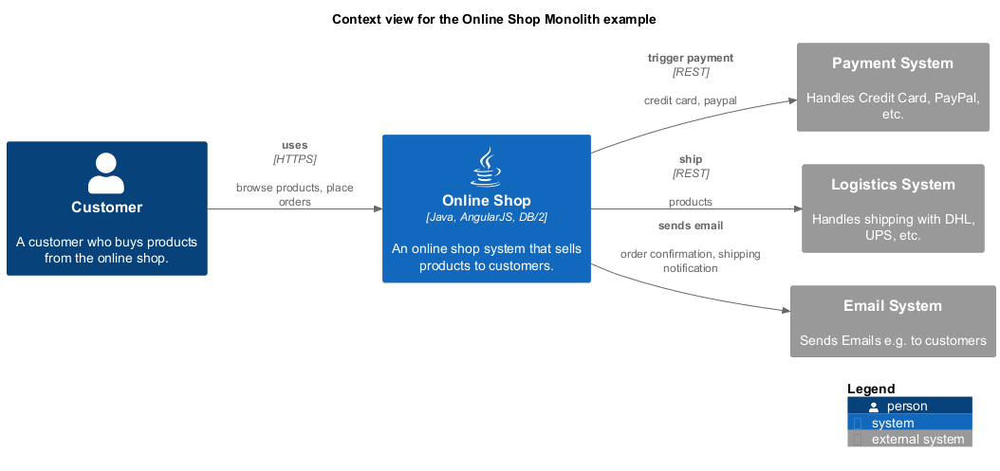
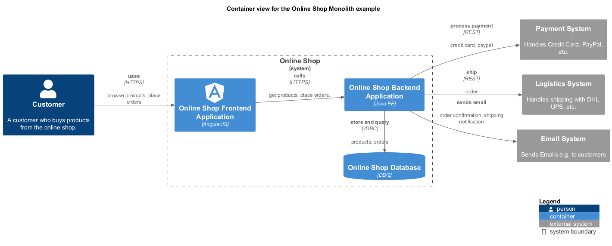
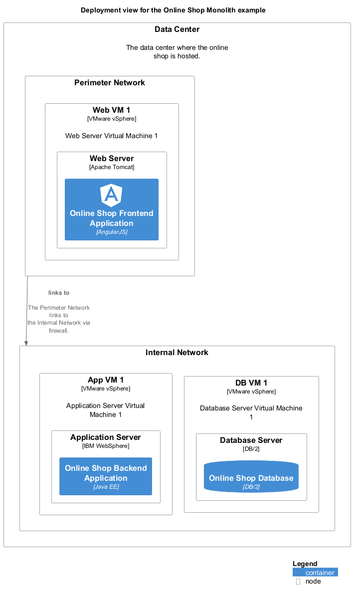

# Architecture Documentation for Online Shop
An online shop system that sells products to customers.

## Table of Content
1. [Introduction and Goals](#introduction-and-goals)
1. [Architecture Constraints](#architecture-constraints)
1. [System Context and Scope](#system-context-and-scope)
1. [Solution Strategy](#solution-strategy)
1. [Building Block View](#building-blocks)
1. [Runtime View](#runtime-view)
1. [Deployment View](#deployment-view)
1. [Crosscutting Concepts](#crosscutting-concepts)
1. [Architectural Decisions](#architecture-decisions)
1. [Quality Requirements](#quality-requirements)
1. [Risk and Technical Dept](#risk-and-technical-dept)

## Introduction and Goals
<!-- PA-BEGIN(Introduction1) -->
<!-- PA-END(Introduction1) -->

<!-- PA-BEGIN(Introduction2) -->
<!-- PA-END(Introduction2) -->

## Architecture Constraints
<!-- PA-BEGIN(ArchitectureConstraints1) -->
<!-- PA-END(ArchitectureConstraints1) -->

<!-- PA-BEGIN(ArchitectureConstraints2) -->
<!-- PA-END(ArchitectureConstraints2) -->

## System Context and Scope
<!-- PA-BEGIN(SystemContext1) -->
<!-- PA-END(SystemContext1) -->

### System Context View

[Context view for the Online Shop Monolith example](../../../../software-development/architecture/example/monolith/context-view.md)

<!-- PA-BEGIN(SystemContext2) -->
<!-- PA-END(SystemContext2) -->

### Scope
<!-- PA-BEGIN(Scope1) -->
<!-- PA-END(Scope1) -->

<!-- PA-BEGIN(Scope2) -->
<!-- PA-END(Scope2) -->

## Solution Strategy
<!-- PA-BEGIN(SolutionStrategy1) -->
<!-- PA-END(SolutionStrategy1) -->

<!-- PA-BEGIN(SolutionStrategy2) -->
<!-- PA-END(SolutionStrategy2) -->

## Building Blocks
<!-- PA-BEGIN(BuildingBlocks1) -->
<!-- PA-END(BuildingBlocks1) -->

### Container View

[Container view for the Online Shop Monolith example](../../../../software-development/architecture/example/monolith/container-view.md)

<!-- PA-BEGIN(BuildingBlocks2) -->
<!-- PA-END(BuildingBlocks2) -->

## Runtime View
<!-- PA-BEGIN(RuntimeView1) -->
<!-- PA-END(RuntimeView1) -->

<!-- PA-BEGIN(RuntimeView2) -->
<!-- PA-END(RuntimeView2) -->

## Deployment View
<!-- PA-BEGIN(DeploymentView1) -->
<!-- PA-END(DeploymentView1) -->

### Deployment Diagram

[Deployment view for the Online Shop Monolith example](../../../../software-development/architecture/example/monolith/deployment-view.md)

<!-- PA-BEGIN(DeploymentView2) -->
<!-- PA-END(DeploymentView2) -->

## Crosscutting Concepts
<!-- PA-BEGIN(CrosscuttingConcepts1) -->
<!-- PA-END(CrosscuttingConcepts1) -->

<!-- PA-BEGIN(CrosscuttingConcepts2) -->
<!-- PA-END(CrosscuttingConcepts2) -->

## Architecture Decisions
<!-- PA-BEGIN(ArchitectureDecisions1) -->
<!-- PA-END(ArchitectureDecisions1) -->

<!-- PA-BEGIN(ArchitectureDecisions2) -->
<!-- PA-END(ArchitectureDecisions2) -->

## Quality Requirements
<!-- PA-BEGIN(QualityRequirements1) -->
<!-- PA-END(QualityRequirements1) -->

<!-- PA-BEGIN(QualityRequirements2) -->
<!-- PA-END(QualityRequirements2) -->

## Risk and Technical Dept
### Risks
<!-- PA-BEGIN(Risk1) -->
<!-- PA-END(Risk1) -->

<!-- PA-BEGIN(Risk2) -->
<!-- PA-END(Risk2) -->

### Technical Dept
<!-- PA-BEGIN(TechnicalDept1) -->
<!-- PA-END(TechnicalDept1) -->

<!-- PA-BEGIN(TechnicalDept2) -->
<!-- PA-END(TechnicalDept2) -->

(generated by [Overarch](https://github.com/soulspace-org/overarch) with template docs/arc42.md.cmb)
