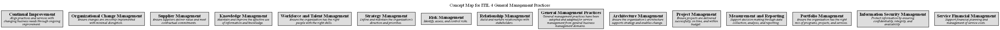

# Concept Map for ITIL 4 General Management Practices

## Diagram

## Description
Contains the general management practices of ITIL 4

## Concepts
| Concept | Description |
|---|---|
| [Architecture Management](../../software-development/itil4/architecture-management-practice.md)| Ensure the organization’s architecture supports strategy and enables change. |
| [Continual Improvement](../../software-development/itil4/continual-improvement-practice.md)| Align practices and services with changing business needs through ongoing improvement. |
| [General Management Practices](../../software-development/itil4/general-management-practices.md)| General management practices have been adopted and adapted for service management from general business management domains. |
| [Information Security Management](../../software-development/itil4/information-security-management-practice.md)| Protect information by ensuring confidentiality, integrity, and availability. |
| [Knowledge Management](../../software-development/itil4/knowledge-management-practice.md)| Maintain and improve the effective use of information and knowledge. |
| [Measurement and Reporting](../../software-development/itil4/measurement-and-reporting-practice.md)| Support decision-making through data collection, analysis, and reporting. |
| [Organizational Change Management](../../software-development/itil4/organizational-change-management-practice.md)| Ensure changes are smoothly implemented with minimal disruption. |
| [Portfolio Management](../../software-development/itil4/portfolio-management-practice.md)| Ensure the organization has the right mix of programs, projects, and services. |
| [Project Management](../../software-development/itil4/project-management-practice.md)| Ensure projects are delivered successfully, on time, and within budget. |
| [Relationship Management](../../software-development/itil4/relationship-management-practice.md)| Build and nurture relationships with stakeholders. |
| [Risk Management](../../software-development/itil4/risk-management-practice.md)| Identify, assess, and control risks. |
| [Service Financial Management](../../software-development/itil4/service-financial-management-practice.md)| Support financial planning and management of service costs. |
| [Strategy Management](../../software-development/itil4/strategy-management-practice.md)| Define and maintain the organization’s direction and priorities. |
| [Supplier Management](../../software-development/itil4/supplier-management-practice.md)| Ensure suppliers deliver value and meet contractual commitments. |
| [Workforce and Talent Management](../../software-development/itil4/workforce-and-talent-management-practice.md)| Ensure the organization has the right people with the right skills. |

## Navigation
[List of views in namespace](./views-in-namespace.md)

[List of all Views](../../views.md)

(generated by [Overarch](https://github.com/soulspace-org/overarch) with template docs/view.md.cmb)

