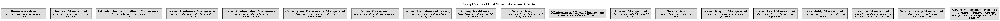

# Concept Map for ITIL 4 Service Management Practices

## Diagram

## Description
Contains the service management practices of ITIL 4

## Concepts
| Concept | Description |
|---|---|
| [Availability Management](../../software-development/itil4/availability-management-practice.md)| Ensure services meet agreed availability targets. |
| [Business Analysis](../../software-development/itil4/business-analysis-practice.md)| Analyze business needs and recommend solutions. |
| [Capacity and Performance Management](../../software-development/itil4/capacity-and-performance-management-practice.md)| Ensure services perform efficiently and meet demand. |
| [Change Enablement](../../software-development/itil4/change-enablement-practice.md)| Maximize successful changes while minimizing risk. |
| [IT Asset Management](../../software-development/itil4/it-asset-management-practice.md)| Plan and manage the lifecycle of IT assets. |
| [Incident Management](../../software-development/itil4/incident-management-practice.md)| Restore normal service as quickly as possible. |
| [Infrastructure and Platform Management](../../software-development/itil4/infrastructure-and-platform-management-practice.md)| Oversee infrastructure to support services. |
| [Monitoring and Event Management](../../software-development/itil4/monitoring-and-event-management-practice.md)| Observe services and respond to events. |
| [Problem Management](../../software-development/itil4/problem-management-practice.md)| Reduce the likelihood and impact of incidents by identifying root causes. |
| [Release Management](../../software-development/itil4/release-management-practice.md)| Make new and changed services available for use. |
| [Service Catalog Management](../../software-development/itil4/service-catalog-management-practice.md)| Provide a single source of consistent service information. |
| [Service Configuration Management](../../software-development/itil4/service-configuration-management-practice.md)| Ensure accurate information about configuration items. |
| [Service Continuity Management](../../software-development/itil4/service-continuity-management-practice.md)| Ensure service availability during major disruptions. |
| [Service Design](../../software-development/itil4/service-design-practice.md)| Design services that meet business and user requirements. |
| [Service Desk](../../software-development/itil4/service-desk-practice.md)| Provide a single point of contact for users. |
| [Service Level Management](../../software-development/itil4/service-level-management-practice.md)| Set clear service targets and ensure they are met. |
| [Service Management Practices](../../software-development/itil4/service-management-practices.md)| Service management practices have been developed in service management and ITSM industries. |
| [Service Request Management](../../software-development/itil4/service-request-management-practice.md)| Handle user requests effectively and efficiently. |
| [Service Validation and Testing](../../software-development/itil4/service-validation-and-testing-practice.md)| Ensure services meet requirements and are fit for use. |

## Navigation
[List of views in namespace](./views-in-namespace.md)

[List of all Views](../../views.md)

(generated by [Overarch](https://github.com/soulspace-org/overarch) with template docs/view.md.cmb)

