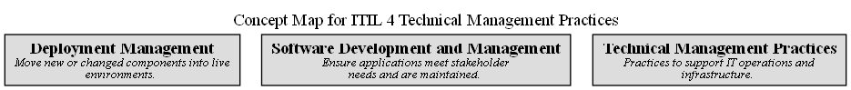

# Concept Map for ITIL 4 Technical Management Practices

## Diagram

## Description
Contains the technical management practices of ITIL 4

## Concepts
| Concept | Description |
|---|---|
| [Deployment Management](../../software-development/itil4/deployment-management-practice.md)| Move new or changed components into live environments. |
| [Software Development and Management](../../software-development/itil4/software-development-and-management-practice.md)| Ensure applications meet stakeholder needs and are maintained. |
| [Technical Management Practices](../../software-development/itil4/technical-management-practices.md)| Practices to support IT operations and infrastructure. |

## Navigation
[List of views in namespace](./views-in-namespace.md)

[List of all Views](../../views.md)

(generated by [Overarch](https://github.com/soulspace-org/overarch) with template docs/view.md.cmb)

