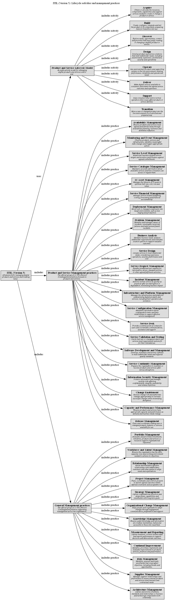

# ITIL (Version 5): Lifecycle activities and management practices

## Diagram

## Description

## Concepts
| Concept | Description |
|---|---|
| [Acquire](../../software-development/itil-v5/lifecycle/acquire.md)| Obtain or allocate the resources, components, capabilities and supplier services needed to create or change a product or service. |
| [Architecture Management](../../software-development/itil-v5/practice/architecture-management.md)| Defines and evolves structures, standards and relationships so business and technology components work coherently. |
| [Availability Management](../../software-development/itil-v5/practice/availability-management.md)| Ensures products and services meet agreed availability needs through availability planning, resilience and downtime reduction. |
| [Build](../../software-development/itil-v5/lifecycle/build.md)| Create, configure, integrate and test the product or its components, preparing them for transition into use. |
| [Business Analysis](../../software-development/itil-v5/practice/business-analysis.md)| Identifies business needs, analyses stakeholder requirements and evaluates solution options to support valuable outcomes. |
| [Capacity and Performance Management](../../software-development/itil-v5/practice/capacity-and-performance-management.md)| Ensures products and services have appropriate capacity and performance as demand and business needs change. |
| [Change Enablement](../../software-development/itil-v5/practice/change-enablement.md)| Assesses change risk and authorizes changes appropriately to increase successful changes while minimizing disruption. |
| [Continual Improvement](../../software-development/itil-v5/practice/continual-improvement.md)| Identifies, prioritizes, implements and evaluates improvements to products, services, practices and performance. |
| [Deliver](../../software-development/itil-v5/lifecycle/deliver.md)| Make digital services available to consumers and enable the agreed service outcomes and experience. |
| [Deployment Management](../../software-development/itil-v5/practice/deployment-management.md)| Moves new or changed components into target environments, such as test, staging and production. |
| [Design](../../software-development/itil-v5/lifecycle/design.md)| Develop product and service solutions that meet stakeholder needs, including functionality, experience, architecture, security and operability. |
| [Discover](../../software-development/itil-v5/lifecycle/discover.md)| Explore needs, opportunities, context and priorities that may justify creating or changing a digital product or service. |
| [General Management practices](../../software-development/itil-v5/general-practices.md)| The official group of 12 ITIL (Version 5) management practices supporting management across the organization. |
| [IT Asset Management](../../software-development/itil-v5/practice/it-asset-management.md)| Manages the lifecycle of IT assets to optimize their use, cost, risk and value. |
| [ITIL (Version 5)](../../software-development/itil-v5/framework.md)| A framework for managing digital products and services and creating value. |
| [Incident Management](../../software-development/itil-v5/practice/incident-management.md)| Restores normal service as quickly as practical after an interruption or degradation, minimizing business impact. |
| [Information Security Management](../../software-development/itil-v5/practice/information-security-management.md)| Protects information and manages security risks affecting confidentiality, integrity, availability and related objectives. |
| [Infrastructure and Platform Management](../../software-development/itil-v5/practice/infrastructure-and-platform-management.md)| Manages the infrastructure and platforms underpinning digital products and services, including their operation and evolution. |
| [Knowledge Management](../../software-development/itil-v5/practice/knowledge-management.md)| Ensures useful knowledge and information are created, maintained, shared and accessible to those who need them. |
| [Measurement and Reporting](../../software-development/itil-v5/practice/measurement-and-reporting.md)| Defines measures, collects reliable data and reports performance to support decisions and demonstrate outcomes. |
| [Monitoring and Event Management](../../software-development/itil-v5/practice/monitoring-and-event-management.md)| Observes products, services and infrastructure, identifies meaningful state changes and triggers appropriate action. |
| [Operate](../../software-development/itil-v5/lifecycle/operate.md)| Run and maintain products and supporting systems in the live environment, meeting performance, reliability and operational needs. |
| [Organizational Change Management](../../software-development/itil-v5/practice/organizational-change-management.md)| Helps people and organizations adopt changes through engagement, communication, preparation and support. |
| [Portfolio Management](../../software-development/itil-v5/practice/portfolio-management.md)| Evaluates and prioritizes investments, initiatives, products and services so resources support organizational objectives. |
| [Problem Management](../../software-development/itil-v5/practice/problem-management.md)| Identifies and manages causes of incidents, investigates recurring failures and helps prevent future incidents. |
| [Product and Service Lifecycle Model](../../software-development/itil-v5/lifecycle-model.md)| An eight-activity model for managing digital products and services end to end. |
| [Product and Service Management practices](../../software-development/itil-v5/product-service-practices.md)| The official group of 22 ITIL (Version 5) management practices focused on products and services. |
| [Project Management](../../software-development/itil-v5/practice/project-management.md)| Plans, coordinates and controls projects to deliver agreed outcomes within defined constraints and acceptable risk. |
| [Relationship Management](../../software-development/itil-v5/practice/relationship-management.md)| Builds and maintains effective relationships with stakeholders, customers and other parties to align needs and expectations. |
| [Release Management](../../software-development/itil-v5/practice/release-management.md)| Plans and coordinates making new or changed products, features or services available for use. |
| [Risk Management](../../software-development/itil-v5/practice/risk-management.md)| Identifies, assesses and treats uncertainty that could affect objectives, including threats and opportunities. |
| [Service Catalogue Management](../../software-development/itil-v5/practice/service-catalogue-management.md)| Maintains accurate information about available services and how consumers can access or request them. |
| [Service Configuration Management](../../software-development/itil-v5/practice/service-configuration-management.md)| Maintains information about configuration items and their relationships to support effective service management. |
| [Service Continuity Management](../../software-development/itil-v5/practice/service-continuity-management.md)| Prepares the organization to maintain or recover products and services after serious disruptions. |
| [Service Design](../../software-development/itil-v5/practice/service-design.md)| Designs services to meet stakeholder needs, considering experience, operations, security, performance and cost. |
| [Service Desk](../../software-development/itil-v5/practice/service-desk.md)| Provides a central point of contact for users and coordinates communications, assistance and support. |
| [Service Financial Management](../../software-development/itil-v5/practice/service-financial-management.md)| Manages service-related budgeting, costing, forecasting and financial accountability. |
| [Service Level Management](../../software-development/itil-v5/practice/service-level-management.md)| Establishes business-aligned service targets and monitors performance against agreed commitments. |
| [Service Request Management](../../software-development/itil-v5/practice/service-request-management.md)| Handles predefined user requests for information, access, standard services or other agreed fulfilment activities. |
| [Service Validation and Testing](../../software-development/itil-v5/practice/service-validation-and-testing.md)| Checks that new or changed products and services meet requirements and are fit for their intended use. |
| [Software Development and Management](../../software-development/itil-v5/practice/software-development-and-management.md)| Develops, maintains and evolves software to meet stakeholder needs and required quality standards. |
| [Strategy Management](../../software-development/itil-v5/practice/strategy-management.md)| Defines organizational direction and aligns plans, capabilities and investments with long-term goals. |
| [Supplier Management](../../software-development/itil-v5/practice/supplier-management.md)| Manages supplier relationships and performance to ensure external products and services meet business and contractual needs. |
| [Support](../../software-development/itil-v5/lifecycle/support.md)| Help consumers and restore normal operation when issues affect products or service delivery. |
| [Transition](../../software-development/itil-v5/lifecycle/transition.md)| Move a new or changed product into the live environment in a controlled and prepared way. |
| [Workforce and Talent Management](../../software-development/itil-v5/practice/workforce-and-talent-management.md)| Ensures the organization has the skills, capacity, roles and working environment needed to achieve its objectives. |

## Other Relationships
| From | Name | To | Description |
|---|---|---|---|
| [ITIL (Version 5)](../../software-development/itil-v5/framework.md) | includes | [Product and Service Management practices](../../software-development/itil-v5/product-service-practices.md) |  |
| [ITIL (Version 5)](../../software-development/itil-v5/framework.md) | includes | [General Management practices](../../software-development/itil-v5/general-practices.md) |  |
| [Product and Service Lifecycle Model](../../software-development/itil-v5/lifecycle-model.md) | includes activity | [Support](../../software-development/itil-v5/lifecycle/support.md) |  |
| [Product and Service Lifecycle Model](../../software-development/itil-v5/lifecycle-model.md) | includes activity | [Acquire](../../software-development/itil-v5/lifecycle/acquire.md) |  |
| [Product and Service Lifecycle Model](../../software-development/itil-v5/lifecycle-model.md) | includes activity | [Operate](../../software-development/itil-v5/lifecycle/operate.md) |  |
| [Product and Service Lifecycle Model](../../software-development/itil-v5/lifecycle-model.md) | includes activity | [Deliver](../../software-development/itil-v5/lifecycle/deliver.md) |  |
| [Product and Service Lifecycle Model](../../software-development/itil-v5/lifecycle-model.md) | includes activity | [Transition](../../software-development/itil-v5/lifecycle/transition.md) |  |
| [Product and Service Lifecycle Model](../../software-development/itil-v5/lifecycle-model.md) | includes activity | [Design](../../software-development/itil-v5/lifecycle/design.md) |  |
| [Product and Service Lifecycle Model](../../software-development/itil-v5/lifecycle-model.md) | includes activity | [Build](../../software-development/itil-v5/lifecycle/build.md) |  |
| [Product and Service Lifecycle Model](../../software-development/itil-v5/lifecycle-model.md) | includes activity | [Discover](../../software-development/itil-v5/lifecycle/discover.md) |  |
| [General Management practices](../../software-development/itil-v5/general-practices.md) | includes practice | [Project Management](../../software-development/itil-v5/practice/project-management.md) |  |
| [Product and Service Management practices](../../software-development/itil-v5/product-service-practices.md) | includes practice | [Service Level Management](../../software-development/itil-v5/practice/service-level-management.md) |  |
| [General Management practices](../../software-development/itil-v5/general-practices.md) | includes practice | [Portfolio Management](../../software-development/itil-v5/practice/portfolio-management.md) |  |
| [General Management practices](../../software-development/itil-v5/general-practices.md) | includes practice | [Supplier Management](../../software-development/itil-v5/practice/supplier-management.md) |  |
| [Product and Service Management practices](../../software-development/itil-v5/product-service-practices.md) | includes practice | [Service Validation and Testing](../../software-development/itil-v5/practice/service-validation-and-testing.md) |  |
| [Product and Service Management practices](../../software-development/itil-v5/product-service-practices.md) | includes practice | [Release Management](../../software-development/itil-v5/practice/release-management.md) |  |
| [General Management practices](../../software-development/itil-v5/general-practices.md) | includes practice | [Architecture Management](../../software-development/itil-v5/practice/architecture-management.md) |  |
| [General Management practices](../../software-development/itil-v5/general-practices.md) | includes practice | [Knowledge Management](../../software-development/itil-v5/practice/knowledge-management.md) |  |
| [General Management practices](../../software-development/itil-v5/general-practices.md) | includes practice | [Workforce and Talent Management](../../software-development/itil-v5/practice/workforce-and-talent-management.md) |  |
| [Product and Service Management practices](../../software-development/itil-v5/product-service-practices.md) | includes practice | [Incident Management](../../software-development/itil-v5/practice/incident-management.md) |  |
| [General Management practices](../../software-development/itil-v5/general-practices.md) | includes practice | [Risk Management](../../software-development/itil-v5/practice/risk-management.md) |  |
| [Product and Service Management practices](../../software-development/itil-v5/product-service-practices.md) | includes practice | [Software Development and Management](../../software-development/itil-v5/practice/software-development-and-management.md) |  |
| [General Management practices](../../software-development/itil-v5/general-practices.md) | includes practice | [Organizational Change Management](../../software-development/itil-v5/practice/organizational-change-management.md) |  |
| [Product and Service Management practices](../../software-development/itil-v5/product-service-practices.md) | includes practice | [IT Asset Management](../../software-development/itil-v5/practice/it-asset-management.md) |  |
| [General Management practices](../../software-development/itil-v5/general-practices.md) | includes practice | [Strategy Management](../../software-development/itil-v5/practice/strategy-management.md) |  |
| [General Management practices](../../software-development/itil-v5/general-practices.md) | includes practice | [Relationship Management](../../software-development/itil-v5/practice/relationship-management.md) |  |
| [Product and Service Management practices](../../software-development/itil-v5/product-service-practices.md) | includes practice | [Monitoring and Event Management](../../software-development/itil-v5/practice/monitoring-and-event-management.md) |  |
| [Product and Service Management practices](../../software-development/itil-v5/product-service-practices.md) | includes practice | [Availability Management](../../software-development/itil-v5/practice/availability-management.md) |  |
| [Product and Service Management practices](../../software-development/itil-v5/product-service-practices.md) | includes practice | [Service Catalogue Management](../../software-development/itil-v5/practice/service-catalogue-management.md) |  |
| [General Management practices](../../software-development/itil-v5/general-practices.md) | includes practice | [Continual Improvement](../../software-development/itil-v5/practice/continual-improvement.md) |  |
| [Product and Service Management practices](../../software-development/itil-v5/product-service-practices.md) | includes practice | [Service Design](../../software-development/itil-v5/practice/service-design.md) |  |
| [Product and Service Management practices](../../software-development/itil-v5/product-service-practices.md) | includes practice | [Change Enablement](../../software-development/itil-v5/practice/change-enablement.md) |  |
| [Product and Service Management practices](../../software-development/itil-v5/product-service-practices.md) | includes practice | [Service Continuity Management](../../software-development/itil-v5/practice/service-continuity-management.md) |  |
| [Product and Service Management practices](../../software-development/itil-v5/product-service-practices.md) | includes practice | [Service Configuration Management](../../software-development/itil-v5/practice/service-configuration-management.md) |  |
| [Product and Service Management practices](../../software-development/itil-v5/product-service-practices.md) | includes practice | [Service Financial Management](../../software-development/itil-v5/practice/service-financial-management.md) |  |
| [Product and Service Management practices](../../software-development/itil-v5/product-service-practices.md) | includes practice | [Capacity and Performance Management](../../software-development/itil-v5/practice/capacity-and-performance-management.md) |  |
| [Product and Service Management practices](../../software-development/itil-v5/product-service-practices.md) | includes practice | [Service Desk](../../software-development/itil-v5/practice/service-desk.md) |  |
| [Product and Service Management practices](../../software-development/itil-v5/product-service-practices.md) | includes practice | [Deployment Management](../../software-development/itil-v5/practice/deployment-management.md) |  |
| [General Management practices](../../software-development/itil-v5/general-practices.md) | includes practice | [Measurement and Reporting](../../software-development/itil-v5/practice/measurement-and-reporting.md) |  |
| [Product and Service Management practices](../../software-development/itil-v5/product-service-practices.md) | includes practice | [Service Request Management](../../software-development/itil-v5/practice/service-request-management.md) |  |
| [Product and Service Management practices](../../software-development/itil-v5/product-service-practices.md) | includes practice | [Business Analysis](../../software-development/itil-v5/practice/business-analysis.md) |  |
| [Product and Service Management practices](../../software-development/itil-v5/product-service-practices.md) | includes practice | [Problem Management](../../software-development/itil-v5/practice/problem-management.md) |  |
| [Product and Service Management practices](../../software-development/itil-v5/product-service-practices.md) | includes practice | [Information Security Management](../../software-development/itil-v5/practice/information-security-management.md) |  |
| [Product and Service Management practices](../../software-development/itil-v5/product-service-practices.md) | includes practice | [Infrastructure and Platform Management](../../software-development/itil-v5/practice/infrastructure-and-platform-management.md) |  |
| [ITIL (Version 5)](../../software-development/itil-v5/framework.md) | uses | [Product and Service Lifecycle Model](../../software-development/itil-v5/lifecycle-model.md) |  |

## Navigation
[List of views in namespace](./views-in-namespace.md)

[List of all Views](../../views.md)

(generated by [Overarch](https://github.com/soulspace-org/overarch) with template docs/view.md.cmb)

